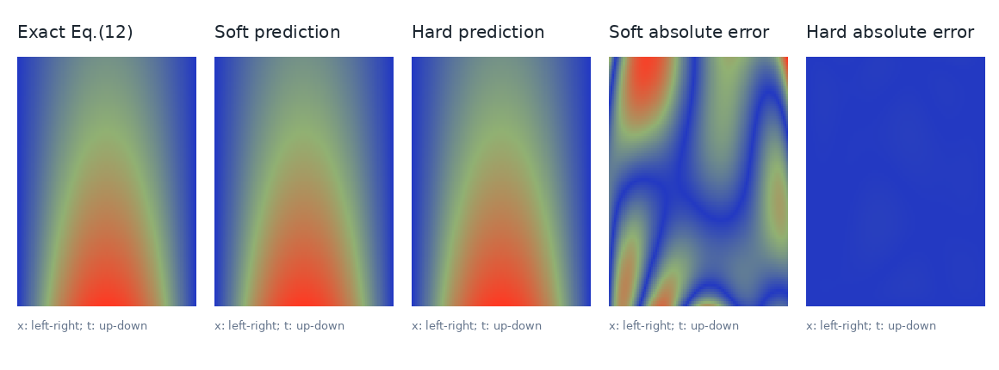
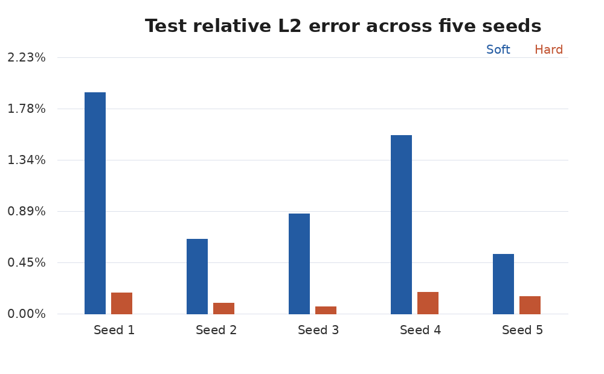

# Soft vs Hard Constraint Enforcement for 1D Heat PINNs

A reproducible Scientific Machine Learning course project based on the framework of **Bowman et al. (2023)**, *Physics-Informed Neural Networks for the Heat Equation with Source Term under Various Boundary Conditions*, *Algorithms* 16(9), 428, [DOI:10.3390/a16090428](https://doi.org/10.3390/a16090428).

## Scope and scientific honesty

This repository has **two distinct experiments**:

1. **Paper-aligned analytic subcase (one matched pair, seed 11):** implement the paper's no-source analytic solution from its **Equation (12)** with a 10-hidden-layer, width-32 Tanh PINN, the reported IC/BC-to-PDE loss-weight ratio, IC/BC sample counts, Latin-hypercube candidate sampling and an L-BFGS training stage; then compare a hard-constraint version under matched settings.
2. **Original extension with known source (five matched seeds 1–5):** solve a manufactured-source heat equation using Soft PINNs and an IC/BC hard-constraint output transformation, comparing held-out errors and stability.

**The first is NOT an exact replication of the paper's PAC1D experiments.** The original PAC1D data were not publicly available in the paper. Further, the paper labels a non-source simulation "insulated", but its analytic sine profile (Eq. 12) has *nonzero boundary gradients*, so its equation-derived boundary temperatures are Dirichlet, not homogeneous Neumann. We explicitly use the analytic solution's **Dirichlet traces** instead of claiming to reproduce insulated flux boundaries. We use nondimensional `alpha=0.1`, a 25,000-point **LHS candidate pool** sampled in minibatches of 256 for Adam, then L-BFGS on a *fixed subset of 1,024* points (not the full 25,000), rather than the original full PAC1D/L-BFGS setup. Do not compare numerical percentages directly to Table 3 of the paper because the dataset, constraints, and metric differ. These departures and all actual step counts are recorded in JSON and logs.

Neither experiment uses interior ground-truth temperature labels for PINN training. Public reference grids are **evaluation-only**, generated analytically and provided in `data/`.

## What is compared?

For both test cases, the PDE is `u_t - alpha * u_xx = Q(x,t)` on `(x,t) in [0,1]^2` with `u(x,0)=sin(pi*x)` and `u(0,t)=u(1,t)=0`.

- **Soft:** `u_theta(x,t)=MLP_theta(x,t)`, optimize `L_PDE + lambda_IC L_IC + lambda_BC L_BC`.
- **Hard:** `u_theta(x,t)=sin(pi*x)+t*x*(1-x)*MLP_theta(x,t)`, optimize `L_PDE`; IC and BC are satisfied by construction, but the PDE remains a **soft** residual constraint.

**Paper-aligned analytic case (no source):** `Q=0`, reference `u*=exp(-alpha*pi^2*t)sin(pi*x)`, 10 hidden layers × 32 neurons, seed 11, 2,000 Adam steps plus 120 nominal L-BFGS iterations. The source case uses different architecture/optimizer and is reported separately.

**Manufactured-source extension:** `alpha=0.1`, `u*=exp(-t)sin(pi*x)+0.2*t*sin(3*pi*x)`; `Q` is derived by substituting this solution into the PDE. 3 hidden layers × 64 neurons, 2,000 Adam epochs, 256 interior collocation points per epoch, Soft weight 10 each for IC and BC, 128 IC and 128 BC samples per epoch. Same raw MLP initialization and interior samples within each seed. Reference used for evaluation only.

## Measured results

### A. Paper-aligned analytic test, seed 11 (n=1)

| Measure | Soft | Hard |
|---|---:|---:|
| Relative L2 test error | 0.330254% | 0.008373% |
| Held-out PDE RMSE | 0.019642 | 0.000802 |
| IC RMSE | 0.001812 | 0 |
| BC RMSE | 0.001487 | ~6.18e-8 |
| R2 | 0.9999577 | 0.99999997 |



### B. Manufactured-source extension, seeds 1–5 (n=5)

| Measure (mean ± sample SD) | Soft | Hard |
|---|---:|---:|
| Relative L2 test error | 1.1009 ± 0.6064% | 0.1331 ± 0.0559% |
| Held-out PDE RMSE | 0.03582 ± 0.00686 | 0.00659 ± 0.00223 |
| IC RMSE | 0.004312 ± 0.002161 | 0 |
| BC RMSE | 0.005574 ± 0.002553 | ~6.18e-8 |



All five paired seeds favor Hard for this specific benchmark and training setup. This does not prove superiority on general PDEs or under tuned Soft loss weights. Approximate speed differences on short CPU runs are not a main result.

## Run from scratch

Tested with CPU PyTorch; required Python packages in `requirements.txt`. The code uses Pillow for figure output (no Matplotlib GUI requirement).

```bash
python -m pip install -r requirements.txt
python validate_project.py
```

Re-run the **paper-aligned** soft/hard pair (overwrites its results):

```bash
python paper_aligned.py
```

Run the five-seed **source** experiment (immediately saves each completed run):

```bash
python run_seed_batch.py 1 2
python run_seed_batch.py 3 4 5
python summarize_multiseed.py
```

To start fresh, delete existing per-seed outputs first, otherwise `run_seed_batch.py` intentionally **skips** saved runs. `python run_multiseed.py` also runs the whole source experiment from scratch. `python pinn_heat.py` reproduces a separate matched seed-42 comparison, not part of five-seed statistics.

Optional notebook: `Results_and_Reproduction.ipynb` displays the **actual saved** paper and source results, and explains how to invoke training; it does not silently run long experiments when opened. `Soft_vs_Hard_PINN_Heat.ipynb` is a pre-executed original seed-42 notebook.

## Files

```text
paper_aligned.py             Paper Eq. (12) analytic test + paired hard extension
pinn_heat.py                 Original source-test code (seed 42)
run_multiseed.py             Five-seed source experiment
run_seed_batch.py            Interrupt-safe per-seed runner
summarize_multiseed.py       Aggregation + plots from completed runs
validate_project.py         Exact PDE, structural and result-integrity tests
Results_and_Reproduction.ipynb  Executed read-only results overview
Soft_vs_Hard_PINN_Heat.ipynb   Executed seed-42 experiment
results/paper_aligned/      Two checkpoints, full training histories, metrics, plot
results/multi_seed/         Ten checkpoints, 2k-epoch histories, metrics, plots
results/                   Seed-42 charts and metrics
report/Final_Report.pdf     Three-page individual report draft
report/Final_Report.md      Editable report source

data/                      Evaluation-only analytic reference grids
```

## Limitations

These experiments examine only one spatial dimension and compatible Dirichlet boundaries; the hard output transform is not a generic imposition of Neumann or convective (Robin) conditions. The paper-aligned test is a single seed and a simplified *analytic* case; the source extension is five seeds, but does not reproduce the paper's layered biological model or its proprietary PAC1D data. Soft weighting was fixed, not tuned or adaptively learned.

## Attribution

Bowman, B., Oian, C., Kurz, J., Khan, T., Gil, E., and Gamez, N. (2023). *Physics-Informed Neural Networks for the Heat Equation with Source Term under Various Boundary Conditions*. Algorithms, 16(9), 428. https://doi.org/10.3390/a16090428
