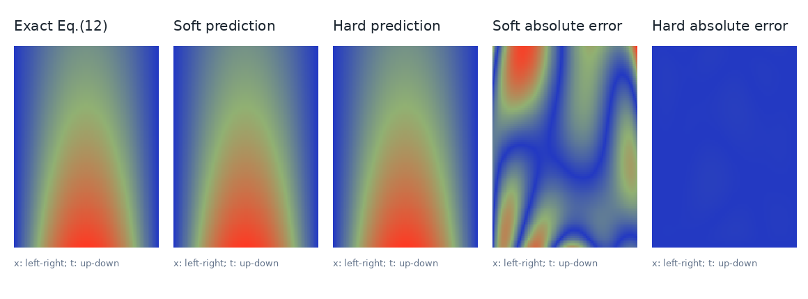
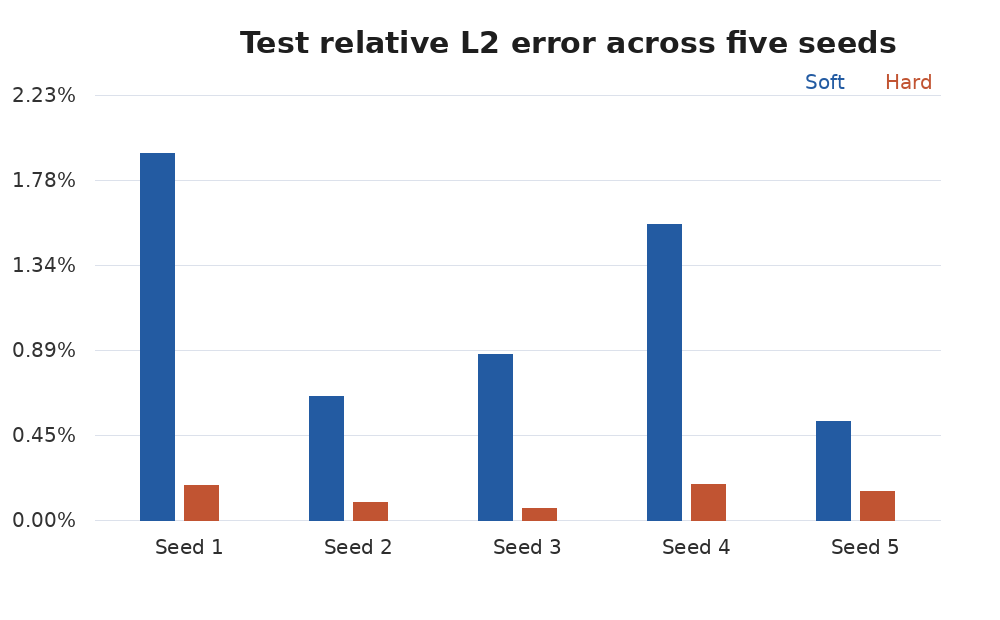

# Soft vs. Hard Constraints in One-Dimensional Heat PINNs
## A paper-aligned analytical reproduction and a controlled extension

**Scientific Machine Learning — Final Project**

### Abstract
We examine how enforcing initial and boundary conditions changes the accuracy of physics-informed neural networks (PINNs) for transient one-dimensional heat conduction. We implement a soft-constraint baseline aligned with the analytic no-source example of Bowman et al. (2023), and compare it against a hard-constraint output transformation. We also test a manufactured-source problem using matched Soft/Hard runs across five random seeds. Hard constraints reduce relative L2 errors in both tested configurations. Our scope is a reproducible *partial* paper reproduction, not a reproduction of the authors' nonpublic PAC1D datasets.

### 1. Problem and methods
The governing equation is \(u_t-\alpha u_{xx}=Q(x,t)\) on \(x,t\in[0,1]\), with \(\alpha=0.1\), \(u(x,0)=\sin(\pi x)\), and homogeneous Dirichlet traces \(u(0,t)=u(1,t)=0\). We compare

- **Soft:** \(u_\theta=N_\theta(x,t)\), \(\mathcal L=\mathcal L_{PDE}+\lambda_{IC}\mathcal L_{IC}+\lambda_{BC}\mathcal L_{BC}\).
- **Hard:** \(u_\theta=\sin(\pi x)+t\,x(1-x)N_\theta(x,t)\), \(\mathcal L=\mathcal L_{PDE}\).

The hard ansatz satisfies the specified IC/BC for all network parameters, but *not* the PDE itself, which remains soft. Both methods use auto-differentiation for \(u_t\) and \(u_{xx}\), and identical model initializations and PDE sampling within a matched pair.

### 2. Paper-aligned analytical test
Bowman et al. (2023, Eq. 12) provide \(u^*=e^{-\alpha\pi^2t}\sin(\pi x)\), which solves the no-source heat equation. We implement a ten-hidden-layer, width-32 Tanh MLP, with a 21:1 IC/BC-to-PDE loss weight, 125 IC samples, 175 BC samples and a Latin-hypercube candidate pool of 25,000 interior points. In contrast to the original full PAC1D/L-BFGS setup, our normalized analytical case uses 2,000 Adam steps (256 interior samples per update), followed by 120 nominal L-BFGS iterations on a fixed subset of 1,024 points. These differences are documented in the code and results files. Also, although the paper describes an "insulated" test, Eq. 12 has nonzero boundary gradients; our analytical test deliberately uses the compatible *Dirichlet temperature traces*, not insulated (zero-flux) conditions.

| Evaluation metric | Soft PINN | Hard PINN |
|:---|---:|---:|
| Relative L2 error | 0.330254% | 0.008373% |
| Held-out PDE residual RMSE | 0.019642 | 0.000802 |
| IC RMSE | 0.001812 | 0 |
| BC RMSE | 0.001487 | approx. 6.18e-8 |
| R2 score | 0.9999577 | 0.99999997 |

The hard model reduces relative L2 error by approximately 97.5% in this **single matched pair**. This number should **not** be compared directly with published PAC1D error percentages because the physical dataset, boundary treatment, training procedure and error metric are different.

### 3. Manufactured-source extension, five seeds
To check robustness on a source-driven PDE we manufacture the analytical solution \(u^*(x,t)=e^{-t}\sin(\pi x)+0.2t\sin(3\pi x)\) and compute the source \(Q=u^*_t-0.1u^*_{xx}\). The analytical solution is used to define a known forcing and for test-set evaluation, **not** as supervised interior temperature labels. Both methods use three 64-unit Tanh hidden layers, Adam with learning rate 1e-3, 2,000 epochs, and 256 interior collocation samples per epoch; Soft additionally uses 128 IC and 128 BC samples per epoch and weights 10/10. Model parameters and PDE samples are matched for each seed in 1–5.

| Evaluation metric, mean ± sample SD (n=5) | Soft | Hard |
|:---|---:|---:|
| Relative L2 test error | 1.1009 ± 0.6064% | 0.1331 ± 0.0559% |
| Held-out PDE residual RMSE | 0.03582 ± 0.00686 | 0.00659 ± 0.00223 |
| IC RMSE | 0.004312 ± 0.002161 | 0 |
| BC RMSE | 0.005574 ± 0.002553 | approx. 6.18e-8 |

The hard formulation yields lower relative errors in all five matched pairs; mean error decreases by 87.9%. Hard also reduces held-out PDE residuals, so the advantage is not only exact IC/BC satisfaction. However, this study covers one spatial dimension, Dirichlet conditions, fixed soft-loss weights, and small run counts; it does not establish general superiority on Neumann/Robin problems or for optimized adaptive soft weighting. All measured data, full histories, weights and reproducible scripts accompany the report.

### Reference
Bowman, B., Oian, C., Kurz, J., Khan, T., Gil, E., and Gamez, N. (2023). "Physics-Informed Neural Networks for the Heat Equation with Source Term under Various Boundary Conditions." *Algorithms*, 16(9), 428. https://doi.org/10.3390/a16090428
